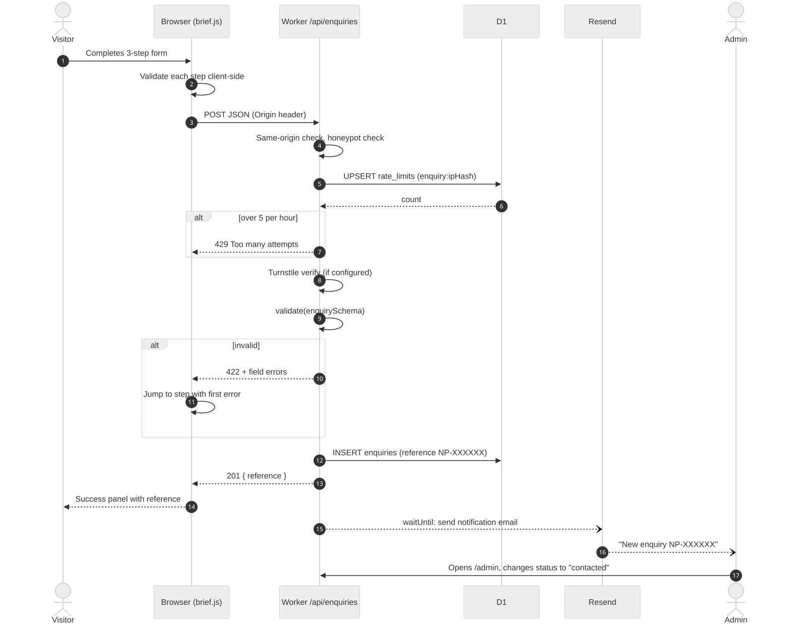
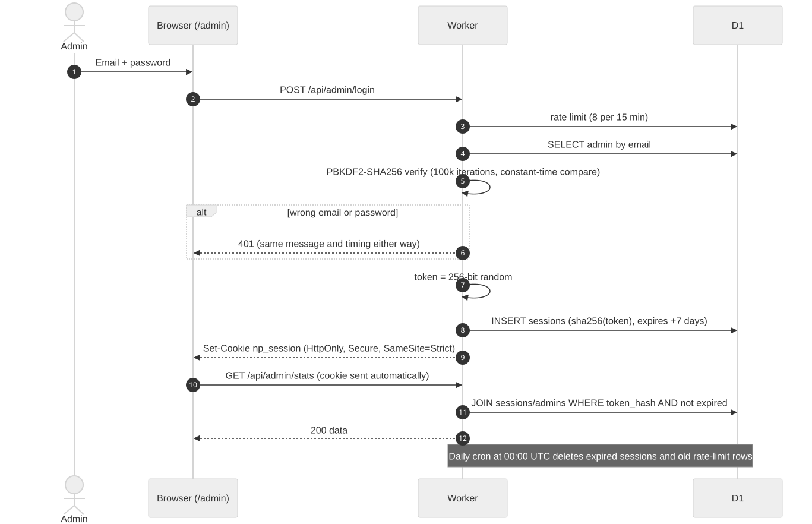

# Architecture

This document describes how the Neuropulse Inc. website is built, why it is built that way, and how a request moves through the system.

## 1. Goals and constraints

| Goal | Consequence |
|---|---|
| Free to host at our scale | Cloudflare Workers Free plan: 100,000 requests per day, a small CPU budget per request, D1 free tier with daily row-read and row-write limits |
| Fast in South Africa | Static files served from Cloudflare's edge (Johannesburg and Cape Town PoPs) |
| Easy for one developer to maintain | No framework, no bundler, one dev dependency; plain HTML, CSS and ES modules |
| Store enquiries, not just email them | D1 database plus an admin dashboard |
| Protect personal data (POPIA) | Salted IP hashes, hashed sessions, consent capture, delete and export tools |

## 2. System context

Mermaid source

See [`diagrams/system-context.mmd`](diagrams/system-context.mmd).

- **Visitors** load static pages from Workers Static Assets. Static requests never run our Worker code, so they don't use the request budget for compute or touch D1.
- **Only `/api/*`** reaches the Worker (`run_worker_first: ["/api/*"]` in `wrangler.jsonc`).
- **D1** stores projects, enquiries, subscribers, admins, sessions, rate limits and the audit log.
- **Resend** (optional) emails the team when an enquiry arrives. Without it, enquiries are still saved and shown in the dashboard.
- **Turnstile** (optional) adds a privacy-friendly bot check to the enquiry form.

## 3. Containers

| Container | Tech | Responsibility | Source |
|---|---|---|---|
| Static site | HTML, CSS, ES modules | Pages, animations, forms, showcase rendering | `src/client/` → built into `public/` |
| Admin SPA | Vanilla JS module | Dashboard UI at `/admin` | `src/client/pages/admin.html`, `src/client/scripts/admin/app.js` |
| API Worker | Cloudflare Worker (JS) | JSON API, auth, validation, rate limiting, cron | `src/server/` |
| Database | Cloudflare D1 (SQLite) | Persistent data | `migrations/` |

## 4. Back-end layers

Rules that keep the code maintainable:

1. **`routes/`** (controllers) parse the request, call validation, and shape the HTTP response. No SQL here.
2. **`services/`** hold business logic and calls to external APIs (login, email, Turnstile).
3. **`repositories/`** are the only place SQL lives. Every query is a prepared statement with bound parameters, so SQL injection is not possible through user input.
4. **`lib/`** contains pure helpers with no Cloudflare dependencies, so they run in Node for unit tests.
5. **`middleware/`** contains cross-cutting guards: CSRF origin check, rate limiting, authentication.

Errors are thrown as `HttpError(status, message, fields)` and converted to JSON in one place (`lib/http.js → errorResponse`). Unknown errors are logged and return a generic 500, so stack traces never leak.

## 5. Request flows

### 5.1 Project enquiry

### 5.2 Admin sign-in

### 5.3 Showcase

`GET /api/projects` returns published projects ordered by `featured DESC, sort_order ASC`. The response is cacheable (`max-age=60`), so repeat visitors and Cloudflare's cache absorb most reads and D1 usage stays tiny. `work.js` renders the cards, so the same module serves the home page preview (`data-limit="4"`) and the full `/work` page with filters.

## 6. Front-end architecture

- **Build step** (`scripts/build.mjs`, zero dependencies): expands partials (`{{> header}}`), injects values from `site.config.json` (`{{site.email}}`), inlines icons (`{{icon:whatsapp}}`), bundles CSS into `site.css` and `admin.css`, and stamps every CSS/JS URL and every relative ES-module import with a content hash. This allows one-year immutable caching without stale files.
- **Progressive loading:** `main.js` dynamically imports only the modules whose markup is on the page (`hero.js` only on the home page, `brief.js` only where the form is).
- **Design tokens** in `styles/tokens.css` come straight from the brand kit: Ink `#0A0C10`, Pulse Blue `#1E9BFF`, Deep Blue `#0B5FD6`, Steel, Mist, Paper; type is Outfit for display and DM Sans for body.
- **Motion budget:** one memorable element (the signal in the top bar, echoed by the hero circuit), plus motion that responds to the user (accordion, form steps, menu). Everything respects `prefers-reduced-motion`, and the canvas pauses when off-screen or in a background tab.
- **Accessibility:** skip link, semantic landmarks, visible focus rings, `aria-current`, `aria-live` regions for async content, keyboard-operable accordion, menu (Esc closes) and dialogs, form errors linked with `aria-describedby`.

## 7. Configuration

| Where | What |
|---|---|
| `wrangler.jsonc → vars` | Non-secret settings: `SITE_URL`, `NOTIFY_EMAIL`, `MAIL_FROM`, `TURNSTILE_SITE_KEY` |
| `wrangler secret put` | Secrets: `IP_SALT`, `RESEND_API_KEY`, `TURNSTILE_SECRET_KEY` |
| `.dev.vars` | Local copies of secrets (git-ignored) |
| `site.config.json` | Company details and social links used at build time |

## 8. Free-plan budget (rough)

| Action | Worker requests | D1 rows read | D1 rows written |
|---|---|---|---|
| Page view (static) | 0 | 0 | 0 |
| Showcase load (cache miss) | 1 | ≈ number of projects | 0 |
| Enquiry submitted | 1 | 1 | 2 (rate limit + enquiry) |
| Admin overview | 1 | a few hundred at most | 0 |

Even thousands of visitors a day stay far inside the free limits. The indexes in `0001_initial_schema.sql` keep row reads low as data grows.

## 9. Key decisions

| Decision | Alternatives considered | Why |
|---|---|---|
| Vanilla JS, no framework | React/Vite, Astro | Smallest maintenance surface, nothing to upgrade, fast first paint, easy to read for new developers |
| Workers Static Assets + Worker API in one deploy | Pages + Functions | Single config, single deploy, Cloudflare's recommended path going forward |
| PBKDF2 (Web Crypto) | bcrypt/argon2 (WASM) | Native, fast enough for the free-plan CPU limit, no dependencies |
| Session cookie, not JWT | JWT in localStorage | HttpOnly cookies can't be read by injected scripts; sessions can be revoked |
| D1 rate limiting | Workers Rate Limiting binding, KV | No extra product, exact counts, one write per check |
