# Database

Cloudflare D1 (SQLite). Database name: `neuropulse-db`, binding: `env.DB`.

## Entity-relationship diagram



Source: [`diagrams/erd.mmd`](diagrams/erd.mmd)

## Tables

| Table | Purpose | Written by | Read by |
|---|---|---|---|
| `projects` | Showcase entries (client sites and in-house products) | Admin dashboard | Public `/api/projects`, dashboard |
| `enquiries` | "Start a project" submissions | Public form | Dashboard, CSV export |
| `subscribers` | Updates list | Footer form | Dashboard, CSV export |
| `admins` | Dashboard users | `scripts/create-admin.mjs` only | Login |
| `sessions` | Active admin sessions (hashed tokens) | Login | Every admin request |
| `rate_limits` | Fixed-window counters per action and hashed IP | Public/admin POSTs | Same |
| `audit_log` | Who changed what in the dashboard | Admin actions | Dashboard overview |

### Status values

- `projects.status`: `live` · `in_development` · `coming_soon`
- `enquiries.status`: `new` → `contacted` → `in_progress` → `won` / `lost` (or `spam`)
- `subscribers.status`: `active` · `unsubscribed`

CHECK constraints enforce these in the database, and `lib/validate.js` enforces them in the API.

### Business rules

- A project is visible on the website only when `published = 1`.
- A project cannot be **live and published without a `url`**, so every live card has a working **Visit site** button.
- `slug` is unique and URL-safe (`a-z`, `0-9`, `-`).
- `enquiries.reference` (e.g. `NP-7K3QX2`) is unique and shown to the visitor so they can quote it on WhatsApp.
- IP addresses are never stored, only `sha256(IP_SALT + ip)` truncated, for rate limiting.

## Indexes

| Index | Serves |
|---|---|
| `idx_projects_public (published, sort_order)` | Public showcase query |
| `idx_enquiries_status_created (status, created_at DESC)` | Dashboard status filter |
| `idx_enquiries_created (created_at DESC)` | Dashboard default list, 7/30-day stats |
| `idx_sessions_expires (expires_at)` | Cron cleanup |
| `idx_audit_created (created_at DESC)` | Recent activity |

## Migrations

Migrations live in `migrations/` and run in filename order. D1 records which ones have been applied.

```bash
npm run db:migrate:local     # local .wrangler/state database
npm run db:migrate:remote    # production
```

**Adding a change:** create the next numbered file, for example `migrations/0003_add_testimonials.sql`. Never edit a migration that has already run in production; add a new one instead.

```bash
npx wrangler d1 migrations create neuropulse-db add_testimonials
```

## Useful queries

```bash
# Count enquiries by status (production)
npx wrangler d1 execute neuropulse-db --remote --command "SELECT status, COUNT(*) FROM enquiries GROUP BY status"

# Back up the whole database to a .sql file
npx wrangler d1 export neuropulse-db --remote --output backup-$(date +%F).sql
```

D1 also keeps automatic point-in-time recovery (Time Travel) for the last 30 days on paid plans and 7 days on the free plan:

```bash
npx wrangler d1 time-travel info neuropulse-db
```
