# Deployment guide



Everything below is free on Cloudflare's Workers Free plan.

## 0. Prerequisites

- A free Cloudflare account: <https://dash.cloudflare.com/sign-up>
- Node.js 20 or newer (`node -v`)
- This project unzipped, with `npm install` done

## 1. Sign in to Cloudflare from your terminal

```bash
npx wrangler login
```

A browser window opens. Click **Allow**.

## 2. Create the production database

```bash
npm run db:create
```

Wrangler prints something like:

```
[[d1_databases]]
binding = "DB"
database_name = "neuropulse-db"
database_id = "a1b2c3d4-...."
```

Copy the `database_id` into `wrangler.jsonc`, replacing `REPLACE_WITH_YOUR_D1_DATABASE_ID`.

## 3. Create the tables

```bash
npm run db:migrate:remote
```

## 4. Set the secrets

```bash
npx wrangler secret put IP_SALT
# paste a long random string, e.g. the output of:  node -e "console.log(crypto.randomUUID()+crypto.randomUUID())"
```

Optional (can be added any time later):

```bash
npx wrangler secret put RESEND_API_KEY         # email alerts for new enquiries
npx wrangler secret put TURNSTILE_SECRET_KEY   # bot protection
```

## 5. Deploy

```bash
npm run deploy
```

This builds the site, runs the tests, does a dry run, then uploads. At the end Wrangler prints your URL:

```
https://neuropulse-inc.<your-subdomain>.workers.dev
```

Open it, then update `SITE_URL` in `wrangler.jsonc` and `url` in `site.config.json` to that address (or your domain) and deploy again, so emails, the sitemap and social previews use the right link.

## 6. Create your admin account

```bash
npm run admin:create -- --email neuropulse.inc@gmail.com --name "Karabo" --remote
```

Then sign in at `https://YOUR-URL/admin`.

## 7. Check it works

```bash
BASE_URL=https://YOUR-URL ADMIN_EMAIL=neuropulse.inc@gmail.com ADMIN_PASSWORD='your-password' npm run test:smoke
```

The smoke test creates and deletes a test enquiry and a test project. Run it right after deploying, not on a busy day.

---

## Optional: email alerts (Resend, free 3,000 emails/month)

1. Sign up at <https://resend.com> with neuropulse.inc@gmail.com and create an API key.
2. `npx wrangler secret put RESEND_API_KEY` and paste the key.
3. Until you verify your own domain in Resend, `MAIL_FROM` must stay `onboarding@resend.dev`, and Resend only delivers to the email you signed up with. That is fine, because alerts go to you.
4. After you own `neuropulseinc.com`, verify it in Resend and change `MAIL_FROM` in `wrangler.jsonc` to `Neuropulse Website <hello@neuropulseinc.com>`.

## Optional: bot protection (Turnstile, free)

1. Cloudflare dashboard → **Turnstile** → **Add widget**. Add your workers.dev hostname (and later your domain).
2. Put the **site key** in `wrangler.jsonc → vars.TURNSTILE_SITE_KEY`.
3. `npx wrangler secret put TURNSTILE_SECRET_KEY` with the **secret key**.
4. `npm run deploy`. The form now shows the "I am human" check automatically.

## Optional: custom domain (neuropulseinc.com)

1. Buy the domain (a `.co.za` from a South African registrar or a `.com` from Cloudflare Registrar at cost).
2. Add the domain to Cloudflare (**Add a site**) and change the nameservers at your registrar if you bought it elsewhere.
3. Add to `wrangler.jsonc`:
   ```jsonc
   "routes": [{ "pattern": "neuropulseinc.com", "custom_domain": true }]
   ```
4. Update `SITE_URL`, `site.config.json → url` and `robots.txt`, then `npm run deploy`.
5. With the domain on Cloudflare you can also use **Email Routing** (free) to receive `hello@neuropulseinc.com` in your Gmail.

## Optional: automatic deploys from GitHub

`.github/workflows/deploy.yml` runs the tests on every push and pull request, and deploys `main` to Cloudflare.

1. Cloudflare dashboard → **My Profile → API Tokens → Create token** → template **Edit Cloudflare Workers**. Also give it **D1: Edit**.
2. GitHub repo → **Settings → Secrets and variables → Actions** → add `CLOUDFLARE_API_TOKEN` and `CLOUDFLARE_ACCOUNT_ID` (shown on the Workers dashboard).
3. Push to `main`.

---

## Operations

| Task | Command |
|---|---|
| Live logs | `npm run logs` |
| Roll back to a previous version | `npx wrangler rollback` |
| List deployments | `npx wrangler deployments list` |
| Back up the database | `npx wrangler d1 export neuropulse-db --remote --output backup.sql` |
| Reset an admin password | `npm run admin:create -- --email … --name … --remote` |

## Troubleshooting

| Symptom | Fix |
|---|---|
| `The database is not connected` (503) | `database_id` in `wrangler.jsonc` is still the placeholder, or migrations have not run |
| `no such table: projects` | Run `npm run db:migrate:remote` (or `:local`) |
| Login works locally but not live | Make sure you created the admin with `--remote` |
| Changes to CSS/HTML don't show locally | Restart `npm run dev` (the build runs on start) |
| `Too many attempts` while testing | Rate limits reset after the window (1 hour for enquiries, 15 minutes for login); locally, delete `.wrangler/state` to reset |
| Daily limit error from D1 | Free-plan daily row limits were reached; they reset at 00:00 UTC (02:00 SAST) |
